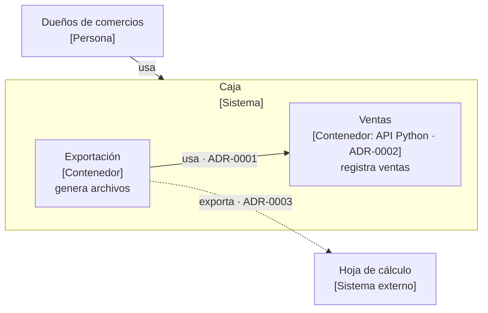

# Diagram — vistas C4 de la arquitectura

Deja en `architecture/diagrams.md` tres vistas del modelo C4, en Mermaid, que
GitHub y los editores muestran dibujadas:

- **Contexto:** quién usa el sistema y con qué sistemas externos habla.
- **Contenedores:** las piezas del sistema (cada componente), su tecnología y
  quién las usa.
- **Componentes:** las partes y sus dependencias, cada una con la decisión
  (ADR) de la que sale.

Lo determinista lo genera el script; tú completas lo que no está en ningún
artefacto estructurado (sistemas externos, tecnologías y el nombre del sistema)
a partir de los ADR y del brief.

## Procedimiento

1. Genera el esqueleto:

   ```bash
   python3 "${CLAUDE_PLUGIN_ROOT}/scripts/architecture.py" diagram
   ```

   - Si sale con código 1, no hay componentes: muestra el motivo y remite a
     `/architecture:init`. No crees el archivo a mano.
   - Si dice que `diagrams.md` **ya existe**, no lo sobrescribe: actualízalo tú
     a mano con lo que haya cambiado en la arquitectura. Para partir de cero,
     el usuario puede borrarlo y volver a ejecutar esta skill, perdiendo lo
     completado.

2. Lee `architecture/diagrams.md`, `architecture/components.md`,
   `architecture/standards.md`, los ADR vigentes de `architecture/adr/` y el
   brief (`product/brief.md`).

3. Completa cada vista sin romper lo que generó el script:
   - Sustituye `_nombre del sistema_` por el nombre del producto.
   - Añade los **sistemas externos** que citan los ADR o el brief (pasarela de
     pago, correo, hoja de cálculo…), con ID `X<Nombre>` y la clase
     `externo`, y la arista que los une citando el ADR que la decide.
   - En contenedores, añade la **tecnología** de cada componente según su ADR
     en la etiqueta: `C1["Ventas<br/>[Contenedor: API Python · ADR-0002]<br/>…"]`.
   - Borra la línea `%% _Completa…_` de cada vista cuando esté hecha.

4. Comprueba y corrige:

   ```bash
   python3 "${CLAUDE_PLUGIN_ROOT}/scripts/architecture.py" check
   ```

## Convenciones



- `flowchart LR`, no la sintaxis C4 experimental de Mermaid.
- IDs: `U1…` usuarios, `SYS` el sistema (también como frontera
  `subgraph SYS`), `C1…` **los IDs de `components.md`, sin cambiarlos**, y
  `X<Nombre>` los sistemas externos. No uses un ID `C…` para nada que no sea un
  componente, ni como frontera de un `subgraph`.
- No inventes componentes: los diagramas dibujan los de `components.md`, y la
  vista de componentes puede detallar sus relaciones, no añadir partes nuevas.
  Si falta una, se añade primero a la arquitectura.
- Clases: `persona`, `sistema`, `contenedor`, `externo` (las `classDef` del
  esqueleto).
- Aristas: `A --> B`, `A -->|texto| B`, `A -- texto --> B`, `A -.-> B` o
  `A -. texto .-> B`. Una dependencia entre componentes cita su ADR en la
  etiqueta: `-->|usa · ADR-0001|`.
- Comillas dentro de una etiqueta: `#quot;`.
- No escribas texto en cursiva (`_así_`) en las etiquetas: la comprobación lo
  toma por un hueco de plantilla (`E-ARCH-TEMPLATE`).

## Qué se comprueba

`check` contrasta los diagramas con la arquitectura:

| Código | Qué lo corrige |
| ------ | -------------- |
| `E-ARCH-DIAGRAM-UNKNOWN` | un nodo `C…` que no existe en `components.md`: quítalo, o, si el usuario lo decide, añade el componente a `components.md` (con `next-id C`) |
| `E-ARCH-DIAGRAM-MISSING` | añade el componente a la vista que se nombra, o la vista que falta |
| `E-ARCH-DIAGRAM-VIOLATION` | la arista contradice el estándar que se nombra: dale la vuelta o quítala |
| `E-ARCH-TEMPLATE` | quedan huecos del esqueleto por completar |

Las capas no se comprueban contra los diagramas, ni los sistemas externos o las
tecnologías.

## Al terminar

Muestra al usuario las tres vistas. Los diagramas se aprueban con el resto del
conjunto en `/architecture:approve`; si la arquitectura ya estaba aprobada,
`check` avisará de que `diagrams.md` no lo está (`W-ARCH-NOT-APPROVED`).

No cambies el campo Estado: lo aprueba el usuario.
