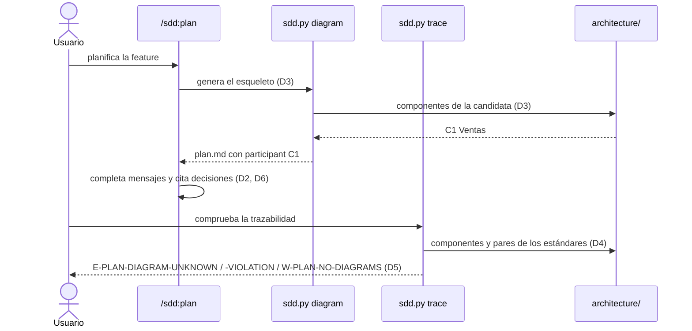

# Plan: diagramas por feature en sdd: secuencia, modelo de datos y clases en el plan

| Campo  | Valor              |
| ------ | ------------------ |
| Spec   | `spec.md`          |
| Fecha  | 2026-10-19           |
| Estado | Approved · 441476a1dfbb              |

> Este documento describe **cómo**. Si aquí aparece un requisito nuevo que no
> está en `spec.md`, el sitio correcto es `spec.md`, no aquí.
>
> Sustituye todo texto en cursiva; si una sección no aplica, escribe
> «No aplica.». Solo el usuario cambia el Estado, con `/sdd:approve`.

## Resumen

La plantilla del plan gana una sección `## Diagramas` con tres apartados
(secuencia, modelo de datos y clases) en Mermaid, cada uno con su «No aplica.».
Un subcomando nuevo, `sdd.py diagram`, escribe en el apartado de secuencia un
esqueleto con los componentes que alojan la feature. `trace` lee los diagramas
de secuencia y los contrasta con los componentes y los estándares de la
arquitectura, con la misma lectura de estándares que `architecture` (copiada,
como manda la constitución). Sin `architecture/`, la sección existe y nada más.

## Comprobación de constitución

| Regla | ¿Se cumple? | Cómo, o excepción justificada |
| ----- | ----------- | ----------------------------- |
| Lo determinista vive en un script | sí | esqueleto, lectura de los diagramas de secuencia y comprobaciones en `sdd.py` y `sdd_trace.py`; la skill `/sdd:plan` solo completa lo que requiere criterio (mensajes, entidades, clases y la decisión que cita cada interacción) |
| Python 3.8, solo biblioteca estándar | sí | Mermaid es texto: se genera y se analiza con `re` |
| Plugins unidos solo por archivos | sí | `sdd` lee `architecture/components.md` y `standards.md` como ya hacía (feature 007); no importa nada de `architecture` |
| Código copiado entre plugins, referenciado y contrastado | sí | la lectura de pares `C2 → C1` de los estándares es copia de `standard_pairs` de `architecture.py`; se documenta en las dos copias y la prueba de contrato de la feature 007 la compara con el `architecture.py` real (D4) |
| Cambiar el formato que lee otro plugin requiere aprobación | sí | ningún formato de otro plugin cambia; `plan.md` es de `sdd` y su sección nueva no la lee nadie más |
| `sdd` funciona sin los demás plugins | sí | sin `architecture/`, `diagram` no escribe nada y `trace` no contrasta los diagramas (D3, D5) |
| Solo el usuario aprueba | sí | `diagram` no cambia el Estado; si el plan ya estaba aprobado, lo dice, porque añadir el esqueleto lo deja cambiado y el usuario tiene que volver a aprobarlo |
| Códigos como contrato y prefijos reservados | sí | tres códigos nuevos con `*-PLAN-*`, que es de `sdd`; se amplía la descripción del prefijo en el registro (`standards-roadmap.md` §7) |
| El selftest cubre cada cambio y todo código es alcanzable | sí | pruebas `test_F009_RNNN_…` en `plugins/sdd/tests/selftest.py` y cobertura de los tres códigos |

## Decisiones

### D1 — Sección `## Diagramas` en la plantilla del plan

- **Contexto:** R001 pide un lugar fijo para los diagramas, y R006 que un plan
  sin él se detecte.
- **Decisión:** `templates/plan.md` gana, tras «Contratos», una sección
  `## Diagramas` con tres apartados: `### Secuencia`, `### Modelo de datos` y
  `### Clases`. Cada uno trae una línea en cursiva que pide un bloque Mermaid
  (`sequenceDiagram`, `erDiagram`, `classDiagram`) o «No aplica.». Esa línea
  es un hueco de plantilla: si se queda, `E-PLAN-TEMPLATE` y la compuerta de
  aprobación lo marcan, como cualquier otro hueco. «No aplica.» lo cierra
  (R001).
- **Alternativas descartadas:**
  - *Un archivo aparte (`diagrams.md`) en la carpeta de la feature.* Tendría
    que entrar en la aprobación y en la huella del plan, y separaría el dibujo
    de las decisiones que explica. En `architecture` sí es aparte porque es un
    conjunto de artefactos; aquí el plan es uno solo.
  - *Diagramas obligatorios.* Una feature de documentación o de guardrails no
    tiene modelo de datos ni clases; por eso cada apartado admite «No aplica.»,
    y la falta de la sección entera solo avisa (R006).
- **Consecuencias:** los planes nuevos llevan la sección. Los anteriores no la
  tienen y reciben `W-PLAN-NO-DIAGRAMS`, sin más.

### D2 — Convenciones de los diagramas

- **Contexto:** la comprobación necesita reconocer los componentes en los
  diagramas, y el usuario quiere entender por qué el plan decide lo que decide.
- **Decisión:**
  - Secuencia: `sequenceDiagram`. Un componente de la arquitectura es un
    participante con su ID (`participant C1 as Ventas`). Los demás participantes
    (usuario, módulos internos, sistemas externos) usan otro ID (`actor U`,
    `participant Repo`, `participant XBanco`).
  - Las llamadas son flechas continuas (`->>`, `->`, `-x`, `-)`); las
    respuestas, discontinuas (`-->>`, `-->`). Solo una llamada cuenta como
    dependencia del que llama hacia el llamado.
  - Cada llamada entre componentes cita en su texto la decisión en la que se
    apoya: `C2->>C1: totales del día (ADR-0001)` o `(D2)` (R008).
  - Modelo de datos: `erDiagram`; clases: `classDiagram`. No se comprueban
    (supuesto de la spec).
- **Alternativas descartadas:**
  - *Contar también las respuestas como dependencias.* Una respuesta `C1-->>C2`
    no hace a C1 depender de C2; contarla daría violaciones falsas en cualquier
    llamada que respeta un estándar.
  - *`flowchart` para el flujo.* El orden de los mensajes es lo que la
    secuencia aporta y lo que la vista C4 de componentes no tiene.
- **Consecuencias:** un diagrama que use `C1` para algo que no es el componente
  C1 dará hallazgos; la skill lo advierte.

### D3 — `sdd.py diagram`: el esqueleto de secuencia

- **Contexto:** R002, R003 y R007.
- **Decisión:** subcomando nuevo sobre el `plan.md` de la feature activa:
  - Sin `architecture/`: no escribe nada, dice que el esqueleto solo se genera
    con arquitectura y sale con 0 (R007).
  - Arquitectura sin aprobar, o candidata sin componente: sale con 1 y lista
    los problemas, como `arch-context`.
  - Sin `plan.md`: sale con 1 y remite a `/sdd:plan`.
  - Si el apartado `### Secuencia` ya tiene algo distinto del hueco de la
    plantilla (un bloque Mermaid, «No aplica.» u otro texto), no toca nada y
    dice que el plan ya tenía diagramas (R003).
  - Si no, escribe en ese apartado, en lugar del hueco, un bloque Mermaid
    `sequenceDiagram` con una línea `participant C1 as Ventas` por componente
    y una línea de comentario `%%` en cursiva. Esa línea pide completar el flujo
    principal, añadir el usuario y los demás participantes, y citar en cada
    llamada entre componentes su decisión (D1, ADR-0001).

    Un participante por componente que aloja la candidata (los de
    `arch-context`). Si la feature no viene de una candidata, no pone
    participantes: el hueco lista los componentes entre los que elegir (R002).
    El hueco lleva `...` para que `E-PLAN-TEMPLATE` y la compuerta lo traten
    como hueco hasta que el modelo lo complete. En las etiquetas, `;` se
    escribe `#59;`, que Mermaid lee como separador.
  - Si el plan no tiene la sección `## Diagramas` (un plan anterior), la añade
    al final con los tres apartados de la plantilla y el esqueleto en el de
    secuencia.
  - Si el plan estaba aprobado, escribe igual y avisa de que ha cambiado y el
    usuario tiene que volver a aprobarlo con `/sdd:approve`.
- **Alternativas descartadas:**
  - *Imprimir el esqueleto para que el modelo lo pegue.* Dejaría lo
    determinista en manos del modelo, contra R002.
  - *Generar también mensajes a partir de los estándares `dependencia`.* Un
    estándar dice quién puede depender de quién, no el orden ni el contenido
    del flujo de esta feature; dibujarlo sería inventar el flujo.
- **Consecuencias:** un comando más en `sdd.py` y una línea en la skill del
  plan.

### D4 — Lectura de pares en `sdd_architecture.py`

- **Contexto:** R005 necesita los pares de los estándares `dependencia` y
  `prohibida`, que hoy solo lee `architecture.py` (`standard_pairs`).
- **Decisión:** `sdd_architecture.standard_pairs(root, kind)` devuelve
  `[(desde, hacia, estándar)]` de los estándares del tipo dado con
  `Detalle: C2 → C1` (o `->`). Es copia de la función de `architecture.py`;
  las dos se nombran entre sí, y la prueba de contrato de la feature 007 se
  amplía para comparar los pares de las dos sobre el mismo `standards.md`.
- **Alternativas descartadas:** *leer los pares en `sdd_trace.py` con su propia
  expresión.* Sería una tercera interpretación del formato sin contraste.
- **Consecuencias:** un cambio del formato del Detalle en `architecture` rompe
  la prueba de contrato, que es lo que se quiere.

### D5 — Comprobaciones nuevas en `trace`

- **Decisión:** sobre los bloques `sequenceDiagram` de la sección
  `## Diagramas` del plan:

  | Código | Requisito | Qué | Cuándo |
  | ------ | --------- | --- | ------ |
  | `E-PLAN-DIAGRAM-UNKNOWN` | R004 | un participante `C\d+` (declarado o en un mensaje) que no es un componente de `components.md`; el mensaje lo nombra | con `architecture/` |
  | `E-PLAN-DIAGRAM-VIOLATION` | R005 | una llamada `Ca->>Cb` cuando un estándar `dependencia` declara `Cb → Ca`, o cuando coincide con un par `prohibida`; el mensaje nombra el estándar | con `architecture/` |
  | `W-PLAN-NO-DIAGRAMS` | R006 | el plan no tiene la sección `## Diagramas`, o la tiene vacía | siempre |

  - Son errores, como `E-PLAN-ADR-UNKNOWN` y los de la feature 008: un
    diagrama que contradice la arquitectura aprobada es tan grave como citar
    una decisión inexistente. Igual que en la feature 007, `trace` los da y la
    compuerta de aprobación del plan no los mira.
  - Se leen las líneas `participant`/`actor` (también con `create`) y los
    mensajes `A->>B:` con sus variantes de flecha. Lo demás (`Note`, `loop`,
    `alt`, `activate`) se ignora.
  - Sin `architecture/`, solo se comprueba `W-PLAN-NO-DIAGRAMS` (R007).
- **Alternativas descartadas:** *avisos en vez de errores.* Un aviso se pierde
  entre los demás y el diagrama seguiría contradiciendo un estándar aprobado
  al implementar.
- **Consecuencias:** tres códigos nuevos en `FINDINGS` y en el contrato
  `sdd.trace/v1`, de forma aditiva.

### D6 — Skill `/sdd:plan` y documentación

- **Decisión:** el paso de arquitectura de la skill del plan añade:
  - ejecutar `sdd.py diagram`;
  - completar los tres apartados según D2, o escribir «No aplica.»;
  - citar en cada llamada entre componentes la decisión del plan o el ADR en
    que se apoya (R008).

  Sin arquitectura, la skill pide igualmente los diagramas, dibujados desde
  cero. El README de `sdd` documenta la sección, el comando, las convenciones
  y los códigos. El registro de prefijos amplía la descripción de `*-PLAN-*`.
- **Alternativas descartadas:** *una skill aparte `/sdd:diagram`.* Los
  diagramas son parte del plan y se aprueban con él; una skill más sería un
  paso que olvidar.
- **Consecuencias:** `/sdd:plan` es un poco más largo.

## Componentes afectados

| Componente | Cambio | Requisitos que cubre |
| ---------- | ------ | -------------------- |
| `plugins/sdd/templates/plan.md` | sección `## Diagramas` con tres apartados (D1) | R001, R006 |
| `plugins/sdd/scripts/sdd.py` | subcomando `diagram` (D3) | R002, R003, R007 |
| `plugins/sdd/scripts/sdd_architecture.py` | `standard_pairs` copiado de `architecture.py` (D4) | R005 |
| `plugins/architecture/scripts/architecture.py` | solo el comentario que nombra la copia de `standard_pairs` (D4) | R005 |
| `plugins/sdd/scripts/sdd_trace.py` | lectura de `sequenceDiagram` y los tres códigos (D5) | R004, R005, R006, R007 |
| `plugins/sdd/skills/plan/SKILL.md` | ejecutar `diagram`, completar y citar decisiones (D6) | R001, R008 |
| `plugins/sdd/README.md`, `plugins/sdd/docs/standards-roadmap.md` | documentación y registro (D6) | R001, R008 |

## Modelo de datos

No aplica. No hay entidades: los diagramas son texto dentro de `plan.md`.

## Contratos

- `sdd.py diagram`: 0 si escribe el esqueleto, si el plan ya tenía diagramas o
  si no hay `architecture/`; 1 sin `plan.md` o con la arquitectura sin
  aprobar.
- `sdd.trace/v1`: tres códigos nuevos (D5), de forma aditiva.
- `sdd_architecture.standard_pairs(root, kind) -> [(desde, hacia, estándar)]`.

## Diagramas

### Secuencia

### Modelo de datos

No aplica.

### Clases

No aplica.

## Estrategia de pruebas

Todas en `plugins/sdd/tests/selftest.py`, sobre la arquitectura de prueba de
la feature 007 (C1 Ventas aloja B01, C2 Exportación aloja B02, S1 `C2 → C1`
con ADR-0001).

| Requisito | Tipo de prueba | Dónde vive |
| --------- | -------------- | ---------- |
| R001 | integración: la plantilla tiene los tres apartados, el hueco se marca y «No aplica.» lo cierra | `test_F009_R001_seccion_de_diagramas` |
| R002 | integración: `diagram` en una feature de B01 pone `participant C1 as Ventas`; sin candidata no pone participantes y lista los componentes | `test_F009_R002_esqueleto_con_componentes` |
| R003 | integración: un segundo `diagram` deja el plan igual byte a byte y dice que ya tenía diagramas | `test_F009_R003_no_sobrescribe` |
| R004 | integración: un participante C7 da `E-PLAN-DIAGRAM-UNKNOWN` con C7 | `test_F009_R004_componente_inexistente` |
| R005 | integración: `C1->>C2` contra S1 y un par prohibido dan `E-PLAN-DIAGRAM-VIOLATION` con el estándar; la respuesta `C1-->>C2` no | `test_F009_R005_llamada_contra_estandar` |
| R006 | integración: un plan sin sección da `W-PLAN-NO-DIAGRAMS` y ningún error | `test_F009_R006_sin_diagramas_avisa` |
| R007 | integración: sin `architecture/`, `diagram` no escribe y `trace` no da hallazgos de diagrama salvo el aviso | `test_F009_R007_sin_arquitectura` |
| R005 (contrato) | contrato: los pares de `sdd_architecture` coinciden con los de `architecture.py` | prueba de contrato de la feature 007, ampliada |

R008 (SHOULD) se cubre con la skill y el hueco del esqueleto, que piden citar
la decisión; no tiene prueba automática.

## Riesgos técnicos

| Riesgo | Impacto | Mitigación |
| ------ | ------- | ---------- |
| La lectura de `sequenceDiagram` no reconoce una variante de flecha | un hallazgo que falta | se prueban todas las flechas de D2; las demás líneas se ignoran, nunca dan un falso error |
| El modelo usa `C1` para otra cosa | falso `E-PLAN-DIAGRAM-UNKNOWN` | convención en la skill (D2) y mensaje que nombra el ID |
| Añadir el esqueleto a un plan aprobado lo deja cambiado | el usuario tiene que volver a aprobar | `diagram` lo avisa (D3) |

## Trazabilidad

Todos los MUST (R001–R007) están en la tabla de componentes y en la de pruebas.
R008 (SHOULD) está en componentes (skill y documentación).
