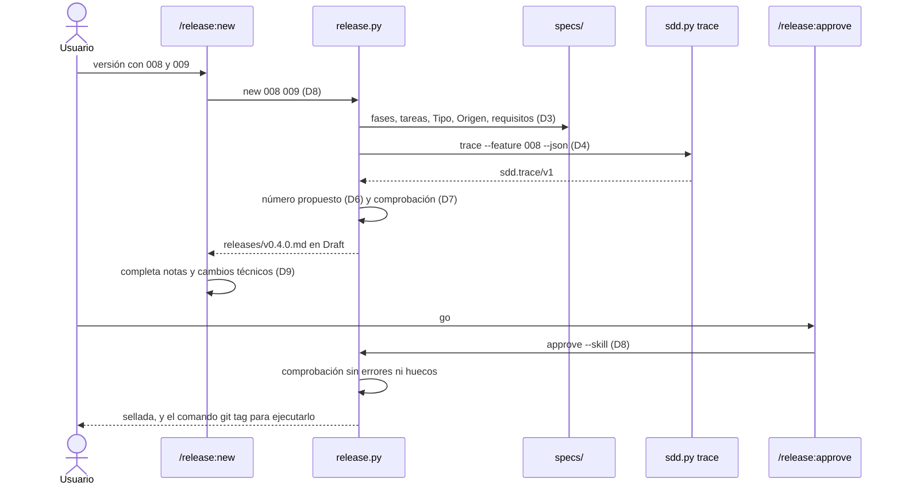
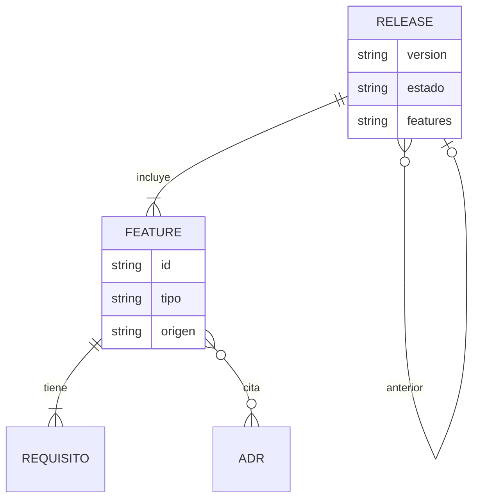

# Plan: plugin release: preparación de versiones con features elegidas

| Campo  | Valor              |
| ------ | ------------------ |
| Spec   | `spec.md`          |
| Fecha  | 2026-10-22         |
| Estado | Approved · 8e119d03cfb1              |

> Este documento describe **cómo**. Si aquí aparece un requisito nuevo que no
> está en `spec.md`, el sitio correcto es `spec.md`, no aquí.
>
> Sustituye todo texto en cursiva; si una sección no aplica, escribe
> «No aplica.». Solo el usuario cambia el Estado, con `/sdd:approve`.

## Resumen

Un plugin nuevo, `release`, con la misma forma que `architecture`: un script
determinista (`release.py`), skills que solo redactan, hooks que protegen la
aprobación y un selftest. Una versión es un archivo `releases/vX.Y.Z.md`.

`release` solo lee `specs/`, porque todo lo que necesita está allí:
- la fila Origen de cada spec trae las candidatas y los objetivos de
  `discovery`;
- la trazabilidad de `sdd` trae las decisiones de arquitectura que cita cada
  plan.

En `sdd` cambian dos cosas pequeñas:
- la plantilla de spec gana la fila `Tipo` (R017);
- `trace` acepta `--feature` (R018), y `release` lo ejecuta como comando y lee
  su contrato público `sdd.trace/v1`.

## Comprobación de constitución

| Regla | ¿Se cumple? | Cómo, o excepción justificada |
| ----- | ----------- | ----------------------------- |
| Lo determinista vive en un script | sí | borrador, comprobaciones, número de versión, sellado y guardrails en `release.py`; las skills solo redactan las notas y el registro de cambios |
| Python 3.8, solo biblioteca estándar | sí | texto Markdown y `subprocess` para la trazabilidad; nada más |
| Plugins unidos solo por archivos | sí | `release` lee `specs/` y ejecuta `sdd.py trace --feature … --json` como comando externo, leyendo su JSON público; no importa código de `sdd` (D4) |
| Cada plugin funciona sin los demás | sí | sin `sdd.py` encontrable, aviso y el resto de comprobaciones (R016); sin `product/` ni `architecture/`, nada que citar ni comprobar (R015) |
| Cambiar el formato que lee otro plugin requiere aprobación | sí | la fila `Tipo` de la spec y `trace --feature` son los cambios en `sdd` que el usuario aprobó en la spec (R017, R018) |
| Código copiado entre plugins, referenciado y contrastado | sí | la lectura de `specs/` es copia del formato de `sdd` (D3) y el analizador de comandos es la cuarta copia del de `sdd_bash.py` (D8); cada copia nombra a las demás, y las pruebas de contrato las contrastan con `sdd` |
| Guardrail que falla abierto y con escape | sí | `guard` y `audit` como en `architecture`, con escape `RELEASE_BYPASS=1`; nunca devuelven `allow` |
| Solo el usuario aprueba | sí | `/release:approve` con `disable-model-invocation: true` y ejecución directa del comando; los hooks protegen `releases/*.md` |
| Códigos como contrato y prefijos reservados | sí | prefijo `*-RELEASE-*` reservado en el registro común antes de usarlo; schema `release.check/v1` |
| Selftest por plugin, todo código alcanzable | sí | `plugins/release/tests/selftest.py`, con comparación de códigos declarados y probados; CI ya recorre `plugins/*/tests/selftest.py` |
| Sin red | sí | nada sale de la máquina |

La tabla «Comprobación» de la constitución dice «3 de 3 plugins». Con
`release` pasa a 4; ese cambio lo hace el usuario con `/sdd:constitution` al
cerrar la feature.

## Decisiones

### D1 — Estructura del plugin

- **Decisión:** `plugins/release/` con la estructura de la constitución:
  - `.claude-plugin/plugin.json`;
  - `hooks/hooks.json` (`guard` en PreToolUse sobre Write|Edit|Bash, `audit` en
    PostToolUse sobre Bash, con timeout 10);
  - `scripts/release.py` (subcomandos) y `scripts/release_specs.py` (lectura
    de `specs/`, D3);
  - `templates/release.md`;
  - `skills/new`, `skills/check` y `skills/approve`;
  - `tests/selftest.py` y `README.md`.

  Entrada nueva en `.claude-plugin/marketplace.json`.
- **Alternativas descartadas:** *Meter la versión en `sdd` como una fase más.*
  Mezcla la etapa de construir una feature con la de publicar varias, y la
  serie es una etapa por plugin.
- **Consecuencias:** un cuarto plugin que mantener, con su selftest en CI.

### D2 — El artefacto `releases/vX.Y.Z.md`

- **Decisión:** un archivo por versión, con:
  - Cabecera: `Estado`, `Versión`, `Fecha`, `Anterior` (la última versión
    aprobada al crearla, o `—`) y `Features` (`008, 009`).
  - `## Contenido`: una subsección `### 008 — <título de la spec>` por feature
    con tres campos: `Tipo`, `Origen` (la fila de la spec, o `—`) y
    `Requisitos` (los IDs vigentes, sin los obsoletos).
  - `## Comprobación`: el resultado de la comprobación al crear el borrador.
    `approve` la reescribe con el resultado del momento de aprobar, que queda
    como evidencia sellada.
  - `## Notas para usuarios`: por feature, una línea en cursiva que pide
    redactar qué cambia para el usuario, citando su candidata y sus objetivos
    de la fila Origen. Si no hay Origen, no los cita (R015).
  - `## Cambios técnicos`: por feature, los datos generados más una línea en
    cursiva que pide resumirlos. Los datos son los requisitos, los `ADR-NNNN`
    que cita su plan y si su plan tiene contenido en «Contratos» y «Modelo de
    datos».

  Las líneas en cursiva son huecos: mientras quede alguno,
  `E-RELEASE-TEMPLATE` impide aprobar (R010).
- **Alternativas descartadas:**
  - *Un único `CHANGELOG.md` acumulado.* La aprobación y la huella son por
    versión, y un archivo acumulado haría que aprobar una versión tocara la
    huella de las anteriores.
  - *No escribir la comprobación en el archivo, solo calcularla.* R001 pide
    que el borrador traiga el resultado, y la versión aprobada debe llevar la
    evidencia de que estaba limpia.
- **Consecuencias:** la sección «Comprobación» del borrador envejece con el
  tiempo. Lo que manda es `check`, y el documento lo dice en su nota de
  cabecera.

### D3 — Lectura de `specs/`: `release_specs.py`

- **Decisión:** es una copia documentada del formato de `sdd`, tomada de
  `sdd_trace.py` y `sdd.py`. Lee lo siguiente:
  - las features de `specs/NNN-slug/` y la resolución de un argumento `008` o
    `008-slug` a su directorio;
  - en la cabecera, el Estado, la huella y las filas `Tipo` y `Origen`;
  - la huella del contenido (`content_digest`, que en `tasks.md` excluye las
    líneas de estado de las tareas);
  - los requisitos con su prioridad, incluidos los obsoletos;
  - las tareas con su estado;
  - las citas `ADR-NNNN` del plan y si sus secciones «Contratos» y «Modelo de
    datos» tienen contenido.

  El comentario de cabecera nombra el original.
  - Hay una prueba de contrato en el selftest de `release`. Crea una feature
    con el `sdd.py` real (`new`, y `approve` de cada fase) y comprueba que
    `release_specs` ve las tres fases aprobadas. Después edita la spec y
    comprueba que la ve cambiada, igual que `sdd.py status`.
  - Un `tasks.md` con tareas en `[~]` y `[x]` se lee igual que lo lee `trace`.
- **Alternativas descartadas:** *Sacar el estado de las fases de `sdd.py
  status`.* Es salida para personas, no un contrato. Además, solo cubre la
  feature activa.
- **Consecuencias:** es otra copia del formato de `sdd`, igual que
  `sdd_architecture.py` lo es del de `architecture`, y la prueba de contrato
  la vigila.

### D4 — La trazabilidad: `sdd.py trace --feature`

- **Decisión:**
  - **En `sdd`:** `trace --feature <NNN|NNN-slug>` analiza esa feature en vez
    de la activa, con el mismo `--json` y `--check`. No toca `.sdd/current`.
    Si la feature no existe, sale con 1 y la nombra (R018).
  - **En `release`:** busca `sdd.py` en este orden y se queda con el primero
    que exista:
    1. la variable de entorno `SDD_SCRIPT`;
    2. `<raíz del plugin>/../sdd/scripts/sdd.py`, la disposición del
       repositorio y de un enlace de desarrollo;
    3. `<raíz del plugin>/../../sdd/*/scripts/sdd.py`, la caché de plugins del
       marketplace; si hay varias versiones, la más reciente.

    Lo ejecuta con `trace --feature NNN --json`, con `CLAUDE_PROJECT_DIR` del
    proyecto y un tiempo máximo de 60 s, y lee `findings` de
    `sdd.trace/v1`:
    - si hay un `E-PLAN-ADR-UNKNOWN` o `E-PLAN-ADR-NOT-APPROVED`, da
      `E-RELEASE-FEATURE-ADR` con su mensaje (R005);
    - si hay cualquier otro error, da `E-RELEASE-FEATURE-TRACE`, que nombra la
      feature y el primer código (R004).
  - **Sin trazabilidad:** si no encuentra `sdd.py`, si el comando falla o si
    la salida no se puede leer, da `W-RELEASE-NO-TRACE` y aplica el resto de
    comprobaciones (R016).
- **Alternativas descartadas:**
  - *Importar `sdd_trace` en un subproceso.* Dependería del código interno de
    `sdd` y no de su contrato.
  - *Comprobar solo lo visible en archivos.* Dejaría R004 sin cumplir.
- **Consecuencias:**
  - R005 depende de la trazabilidad de `sdd`, que ya contrasta los planes con
    la arquitectura (feature 007): `release` no lee `architecture/` y no lleva
    otra copia de su formato.
  - Sin trazabilidad, R005 tampoco se comprueba, y el aviso lo dice.

### D5 — La fila `Tipo` en la spec

- **Decisión:**
  - `templates/spec.md` de `sdd` gana `| Tipo   | funcionalidad |` en la
    cabecera, tras `Estado`. El otro valor es `corrección`.
  - `release` acepta los dos valores y sus variantes sin tilde ni mayúsculas.
    Una spec sin la fila cuenta como `funcionalidad`.
  - Cualquier otro valor da `E-RELEASE-FEATURE-TYPE`, que nombra la feature y
    el valor (R017).
  - La skill `/sdd:specify` dice que el usuario la cambia a `corrección` si la
    feature solo corrige.
- **Alternativas descartadas:** *Deducir el tipo del título o de la
  descripción.* No es determinista.
- **Consecuencias:** `sdd` no comprueba el valor; lo comprueba `release`, que
  es quien lo usa.

### D6 — El número de versión

- **Decisión:**
  - Las versiones son `MAYOR.MENOR.PARCHE`, enteros sin ceros a la izquierda.
  - **Versión publicada:** la que se aprobó alguna vez, es decir, la que
    tiene `Approved · <huella>` en el Estado, aunque haya cambiado después.
    Una edición posterior, como una errata en las notas, solo da el aviso de
    R012: no la «despublica». Así sus features no se pueden volver a incluir
    (R006) y su número sigue contando (R008).
  - La última versión aprobada es la mayor de las publicadas.
  - Propuesta (R007):

    | Caso | Propuesta |
    | ---- | --------- |
    | No hay ninguna aprobada | 0.1.0 |
    | Alguna feature tiene un requisito `OBSOLETO` | mayor: `X+1.0.0`. En `0.y.z`, `0.(y+1).0`, como dice R007 para la serie 0.x |
    | Alguna feature es `funcionalidad` | menor |
    | Todas son `corrección` | parche |

  - El usuario puede fijar otro número al crear: `new 008 009 --version 1.0.0`.
  - Un número mal formado, igual o menor que la última aprobada, repetido, o
    distinto del nombre del archivo da `E-RELEASE-VERSION` con los dos números
    (R008).
- **Alternativas descartadas:**
  - *Que un `OBSOLETO` no suba la mayor.* R007 dice que retirar un requisito
    rompe. Un `OBSOLETO` de una enmienda durante el desarrollo, que no retira
    nada publicado, se corrige fijando el número. La skill lo explica.
  - *Contar solo las versiones aprobadas y sin cambios.* Una errata corregida
    en una versión ya publicada liberaría sus features para otra versión y
    bajaría el último número (hallazgo de `/sdd:analyze`).
- **Consecuencias:** la propuesta es prudente. Puede proponer una mayor que el
  usuario rebaja.

### D7 — `check` y los códigos

- **Decisión:**
  - `release.py check [vX.Y.Z] [--json] [--check]` comprueba la versión
    indicada, o todas las de `releases/`.
  - En las versiones publicadas (D6) solo se mira si cambiaron tras aprobarse:
    una versión publicada no se vuelve a juzgar por cómo evolucionan sus
    features.
  - `--json` emite `release.check/v1`, con `{schema, ok, counts, findings:
    [{code, severity, message, artifact}]}`, como `architecture.check/v1`.
  - `--check` sale con 1 si hay errores (R014).

  | Código | Requisito | Qué |
  | ------ | --------- | --- |
  | `E-RELEASE-NO-FEATURES` | R001 | la versión no incluye ninguna feature |
  | `E-RELEASE-FEATURE-UNKNOWN` | R006 | una feature incluida no existe en `specs/` |
  | `E-RELEASE-FEATURE-RELEASED` | R006 | la feature ya está en otra versión publicada (D6), que se nombra |
  | `E-RELEASE-FEATURE-NOT-APPROVED` | R002 | una fase sin aprobar o cambiada tras aprobarse; nombra la feature y la fase |
  | `E-RELEASE-FEATURE-OPEN-TASKS` | R003 | tareas sin cerrar, nombradas |
  | `E-RELEASE-FEATURE-TRACE` | R004 | la trazabilidad de la feature tiene errores |
  | `E-RELEASE-FEATURE-ADR` | R005 | el plan cita una decisión de arquitectura no aprobada |
  | `E-RELEASE-FEATURE-TYPE` | R017 | el valor de `Tipo` no es ninguno de los dos |
  | `E-RELEASE-VERSION` | R008 | número mal formado, no mayor que la última publicada (D6), repetido o distinto del archivo |
  | `E-RELEASE-TEMPLATE` | R010 | quedan huecos en cursiva |
  | `W-RELEASE-NOT-APPROVED` | R012 | la versión no está aprobada, o cambió tras aprobarse; en ese caso sigue publicada y el aviso lo dice |
  | `W-RELEASE-NO-TRACE` | R016 | la trazabilidad de una feature no se pudo obtener |

- **Alternativas descartadas:** *Un código por fase (`…-SPEC-NOT-APPROVED`…).*
  La fase va en el mensaje, y menos códigos son menos contrato.
- **Consecuencias:** doce códigos nuevos, de forma aditiva, con el prefijo
  reservado.

### D8 — `new`, `approve` y los guardrails

- **Decisión:**
  - **`release.py new <features…> [--version X.Y.Z]`:**
    - sin features, sale con 1 y dice cómo elegirlas (R001);
    - si el archivo de esa versión ya existe, no lo toca;
    - si no, escribe el borrador de D2 con la comprobación del momento y
      muestra los errores, aunque los haya: el borrador sirve para corregirlos.
  - **`release.py approve [vX.Y.Z] [--skill]`:**
    - se niega, sin cambiar nada, si hay errores o huecos (R010);
    - si no, reescribe «Comprobación», sella con `Approved · <huella>` y
      muestra `git tag -a vX.Y.Z -m "…"` y `git push origin vX.Y.Z` para que
      los ejecute el usuario (R011);
    - sin argumento, aprueba la única versión en borrador; si hay varias, pide
      cuál.
  - **`guard`:** deniega escrituras que pongan `Approved` o una huella en el
    Estado de `releases/*.md`, y los comandos que ejecuten `release.py
    approve`.
  - **`audit`:** revierte lo que un comando opaco haya aprobado (R013).
  - Los dos hooks siguen el patrón de `architecture`: instantánea por
    `tool_use_id`, fallo abierto y escape `RELEASE_BYPASS=1`.
  - El analizador de comandos es copia del de `architecture.py`, que copia el
    de `discovery.py` y el de `sdd_bash.py`. Las cuatro copias se nombran entre
    sí, y el selftest usa la misma lista de casos `MENCIONES`/`EJECUCIONES`.
- **Alternativas descartadas:** *Que `approve` cree la etiqueta git.* El
  usuario eligió que el plugin no etiquete ni publique.
- **Consecuencias:**
  - Es la cuarta copia del analizador de comandos. Si se arregla en una, hay
    que replicarlo en las demás; está documentado.
  - Un comentario en `sdd_bash.py`, `discovery.py` y `architecture.py` nombra
    la nueva copia: solo cambian comentarios.

### D9 — Skills y documentación

- **Decisión:**
  - **`/release:new <features…>`** (`disable-model-invocation`):
    - ejecuta `new`;
    - si hay errores, los explica y remite a la fase de `sdd` que los corrige;
    - completa las notas para usuarios en lenguaje del producto, citando
      candidatas y objetivos;
    - completa los cambios técnicos;
    - ejecuta `check`.
  - **`/release:check`:** solo lee; lo puede lanzar el modelo.
  - **`/release:approve`:** ejecución directa
    `!python3 … approve --skill`, como `/architecture:approve`.
  - Documentación:
    - el README del plugin;
    - el README raíz: la serie con `release` y la instalación;
    - el registro de prefijos: `*-RELEASE-*`;
    - el README de `sdd`: `--feature` y la fila `Tipo`.
- **Alternativas descartadas:** *Que `/release:new` también apruebe.* La
  aprobación es del usuario.
- **Consecuencias:** tres skills, la mínima superficie.

## Componentes afectados

| Componente | Cambio | Requisitos que cubre |
| ---------- | ------ | -------------------- |
| `plugins/sdd/templates/spec.md`, `plugins/sdd/skills/specify/SKILL.md` | fila `Tipo` (D5) | R017 |
| `plugins/sdd/scripts/sdd.py`, `plugins/sdd/scripts/sdd_trace.py` | `trace --feature` (D4) | R018 |
| `plugins/release/scripts/release_specs.py` | lectura de `specs/` (D3) | R002, R003, R006, R009, R017 |
| `plugins/release/scripts/release.py` | `new`, `check`, número de versión, trazabilidad (D2, D4, D6, D7) | R001–R010, R014–R017 |
| `plugins/release/scripts/release.py` | `approve`, `guard`, `audit` (D8) | R010, R011, R012, R013 |
| `plugins/release/templates/release.md` | el artefacto (D2) | R001, R009 |
| `plugins/release/skills/*`, `plugins/release/hooks/hooks.json`, `.claude-plugin/plugin.json` | skills y hooks (D8, D9) | R009, R011, R013 |
| `.claude-plugin/marketplace.json`, `README.md`, `plugins/release/README.md`, `plugins/sdd/README.md`, `plugins/sdd/docs/standards-roadmap.md` | catálogo, documentación y registro (D1, D9) | R014 |

## Modelo de datos

No hay base de datos. El dato nuevo es el archivo `releases/vX.Y.Z.md` de D2,
que nombra las features de `specs/` que incluye.

## Contratos

- `release.py new <features…> [--version X.Y.Z]`: 0 si escribe el borrador o ya
  existía; 1 sin features o con un número mal formado.
- `release.py check [vX.Y.Z] [--json] [--check]`: `release.check/v1`; 1 con
  `--check` y errores.
- `release.py approve [vX.Y.Z] [--skill]`: 0 si aprueba; 1 si se niega; con
  `--skill`, siempre 0.
- `release.py guard` y `audit`: hooks, con JSON por stdin.
- `sdd.py trace --feature <NNN|NNN-slug> [--json] [--check]`: igual que `trace`
  sobre esa feature; 1 si no existe.
- Fila `| Tipo | funcionalidad |` o `| Tipo | corrección |` en la cabecera de
  `spec.md`.

## Diagramas

### Secuencia

### Modelo de datos

### Clases

No aplica. Son funciones en dos módulos, sin clases.

## Estrategia de pruebas

En `plugins/release/tests/selftest.py`, sobre features de prueba escritas en
el formato de `sdd`:

| Requisito | Tipo de prueba | Dónde vive |
| --------- | -------------- | ---------- |
| R001 | integración: `new 008 009` escribe el borrador con features, requisitos y comprobación; sin features, sale con 1 | `test_F010_R001_borrador` |
| R002 | integración: plan en Draft y spec cambiada tras aprobar | `test_F010_R002_fases_sin_aprobar` |
| R003 | integración: T004 en `[~]` | `test_F010_R003_tareas_abiertas` |
| R004 | integración: un `sdd.py` falso (`SDD_SCRIPT`) que devuelve un `E-REQ-NO-TEST` | `test_F010_R004_trazabilidad_con_errores` |
| R005 | integración: el falso devuelve `E-PLAN-ADR-NOT-APPROVED` con ADR-0004 | `test_F010_R005_adr_no_aprobado` |
| R006 | integración: 008 en una versión aprobada; 042 inexistente | `test_F010_R006_ya_publicada_o_inexistente` |
| R007 | unitaria e integración: 0.1.0, 0.3.2 → 0.4.0, 1.4.0 → 2.0.0, 0.4.0 → 0.4.1, spec sin Tipo | `test_F010_R007_numero_propuesto` |
| R008 | integración: 0.3.9 tras 0.4.0, repetido, archivo distinto | `test_F010_R008_numero_invalido` |
| R009 | integración: huecos que citan B01 y G1; cambios técnicos con requisitos y ADR | `test_F010_R009_notas_y_cambios` |
| R010 | integración: approve se niega con huecos y con errores, sin cambiar nada | `test_F010_R010_no_se_aprueba_incompleta` |
| R011 | integración: approve sella y muestra `git tag` | `test_F010_R011_aprobacion` |
| R012 | integración: editar las notas tras aprobar avisa, y la versión sigue contando para R006 y R008 | `test_F010_R012_cambio_tras_aprobar` |
| R013 | integración: guard deniega Write/Edit/Bash; audit revierte; escape; nunca `allow` | `test_F010_R013_guardrails` |
| R014 | integración: `check --check` sale con 1 y `--json` trae el código | `test_F010_R014_check_en_ci` |
| R015 | integración: sin Origen ni arquitectura, sin citas ni hallazgos de arquitectura | `test_F010_R015_sin_producto_ni_arquitectura` |
| R016 | integración: sin `sdd.py`, aviso y el resto de comprobaciones | `test_F010_R016_sin_trazabilidad` |
| R017 | integración (sdd): la plantilla trae `Tipo`; (release) valor desconocido da error | `test_F010_R017_tipo` en los dos selftests |
| R018 | integración (sdd): `trace --feature 008` igual que con 008 activa, sin cambiar `.sdd/current`; 042 sale con 1 | `test_F010_R018_trace_de_otra_feature` |
| R002, R004 (contrato) | contrato: `release_specs` frente al `sdd.py` real (D3), y `trace --feature` real dentro del repositorio | `test_F010_R002_contrato_con_sdd` |

## Riesgos técnicos

| Riesgo | Impacto | Mitigación |
| ------ | ------- | ---------- |
| No encontrar `sdd.py` en una instalación del marketplace | sin R004 ni R005 en esa máquina | orden de búsqueda de D4, `SDD_SCRIPT` como escape y el aviso `W-RELEASE-NO-TRACE` |
| La copia del formato de `sdd` se desalinea | una feature mal juzgada | prueba de contrato con el `sdd.py` real (D3) |
| `trace` lento en repositorios grandes | `check` lento con muchas features | tiempo máximo de 60 s por feature; las aprobadas no se vuelven a trazar |
| Cuarta copia del analizador de comandos | un arreglo que no se replica | comentarios cruzados y lista de casos común (D8) |

## Trazabilidad

Todos los MUST (R001–R015, R017, R018) y R016 (SHOULD) aparecen en la tabla
de componentes y en la de pruebas.
