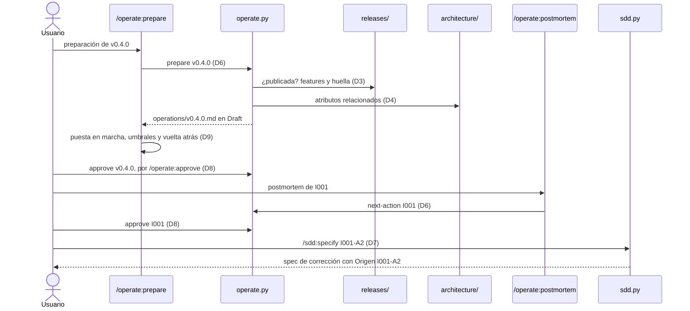
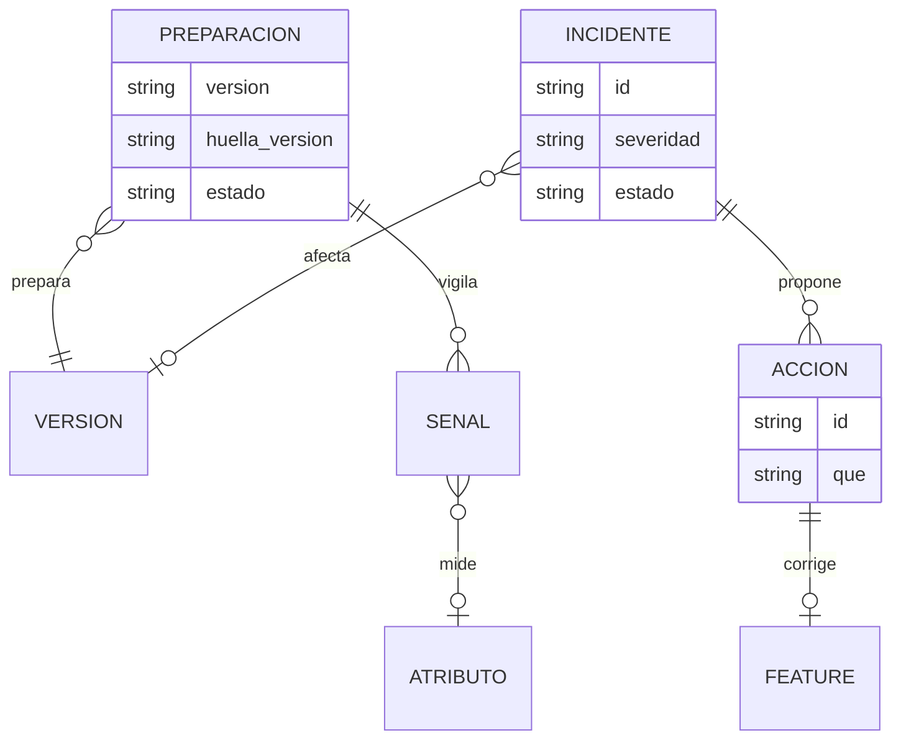

# Plan: plugin operate: preparación operativa e incidentes con postmortems

| Campo  | Valor              |
| ------ | ------------------ |
| Spec   | `spec.md`          |
| Fecha  | 2026-10-27         |
| Estado | Approved · 8e9098240f4e              |

> Este documento describe **cómo**. Si aquí aparece un requisito nuevo que no
> está en `spec.md`, el sitio correcto es `spec.md`, no aquí.
>
> Sustituye todo texto en cursiva; si una sección no aplica, escribe
> «No aplica.». Solo el usuario cambia el Estado, con `/sdd:approve`.

## Resumen

Un plugin nuevo, `operate`, con la forma de `release`:
- un script determinista, `operate.py`;
- skills que solo redactan;
- hooks que protegen la aprobación;
- un selftest.

Deja dos tipos de artefacto en `operations/`:
- la **preparación** de una versión, `operations/vX.Y.Z.md`;
- un archivo por **incidente** con su postmortem, `operations/incidents/I001-slug.md`, más el registro `operations/incidents.md`, que guarda todos los identificadores emitidos.

`operate` lee, como copias documentadas de su formato y sin importar código:
- `releases/` (de `release`);
- los atributos de calidad y las decisiones de `architecture/`;
- la fila `Origen` y las citas `ADR-NNNN` de `specs/` (de `sdd`).

En `sdd` cambia una cosa (R013, R014, R018): `sdd.py new I001-A2` crea una feature de corrección desde una acción de un postmortem aprobado. Lo hace como el traspaso desde `discovery`, con su propia copia del formato de `operations/`.

## Comprobación de constitución

| Regla | ¿Se cumple? | Cómo, o excepción justificada |
| ----- | ----------- | ----------------------------- |
| Lo determinista vive en un script | sí | borradores, identificadores, señales propuestas, comprobación, sellado y guardrails en `operate.py`; las skills redactan procedimiento, señales, vuelta atrás y postmortem |
| Python 3.8, solo biblioteca estándar | sí | texto Markdown; nada más |
| Plugins unidos solo por archivos | sí | `operate` lee `releases/`, `architecture/` y `specs/`; `sdd` lee `operations/`. Ninguno importa código del otro (D3, D7) |
| Cada plugin funciona sin los demás | sí | sin `releases/` no hay preparación pero sí incidentes; sin `architecture/`, preparación sin señales propuestas; sin `operations/incidents.md`, `sdd new` igual que siempre (R017, R018) |
| Cambiar el formato que lee otro plugin requiere aprobación | sí | `sdd` acepta un ID de acción y escribe una fila `Origen` nueva (`I001-A2 · 0.4.0`) que leen `release` y `operate`; el usuario lo aprobó en la spec (R013) |
| Código copiado entre plugins, referenciado y contrastado | sí | `operate_sources.py` copia la lectura de `release`, `architecture` y `sdd`; `sdd_operate.py` copia la de `operate`; el analizador de comandos es la quinta copia. Cada copia nombra a las demás y tiene prueba de contrato con el plugin real (D3, D7, D8) |
| Guardrail que falla abierto y con escape | sí | `guard` y `audit` como en `release`, con escape `OPERATE_BYPASS=1`; nunca devuelven `allow` |
| Solo el usuario aprueba | sí | `/operate:approve` con `disable-model-invocation: true` y ejecución directa |
| Códigos como contrato y prefijos reservados | sí | `*-PREP-*` e `*-INCIDENT-*` reservados en el registro antes de usarlos; schema `operate.check/v1` |
| Selftest por plugin, todo código alcanzable | sí | `plugins/operate/tests/selftest.py`, con comparación de códigos declarados y probados |
| Sin red | sí | `operate` no lee métricas ni se conecta a nada (non-goal) |

## Decisiones

### D1 — Estructura del plugin

- **Decisión:** `plugins/operate/` con la estructura de la constitución:
  - `.claude-plugin/plugin.json`;
  - `hooks/hooks.json` (`guard` en PreToolUse sobre Write|Edit|Bash, `audit` en PostToolUse sobre Bash, timeout 10);
  - `scripts/operate.py` (subcomandos) y `scripts/operate_sources.py` (lectura de los otros plugins, D3);
  - `templates/preparation.md` y `templates/incident.md`;
  - `skills/prepare`, `skills/incident`, `skills/postmortem`, `skills/check` y `skills/approve`;
  - `tests/selftest.py` y `README.md`.

  Entrada nueva en `.claude-plugin/marketplace.json`.
- **Alternativas descartadas:** *Meter los incidentes en `release`.* Mezcla preparar una versión con lo que pasa después, y la serie es una etapa por plugin.
- **Consecuencias:** quinto plugin, con su selftest en CI.

### D2 — Los artefactos de `operations/`

- **Decisión:**
  - **Preparación, `operations/vX.Y.Z.md`:**
    - Cabecera: `Estado`, `Versión` (`0.4.0 · <huella de releases/v0.4.0.md>`), `Fecha`, `Features`.
    - `## Features`: una línea por feature con su título. La genera el script.
    - `## Puesta en marcha`: pasos y cómo verificar que funciona.
    - `## Señales`: una subsección por señal, `### SG1 — <nombre>`, con los campos `Atributo` (`Q1` o `—`), `Escenario`, `Umbral` y `Cómo se mide`.
    - `## Vuelta atrás`: campos `Pasos` y `Disparador`.
  - **Incidente, `operations/incidents/I001-<slug>.md`:**
    - Cabecera: `Estado`, `ID`, `Fecha`, `Versión afectada` (`0.4.0` o `desconocida`) y `Severidad`.
    - Secciones `## Qué pasó`, `## Impacto`, `## Cronología`, `## Causas` y `## Acciones`.
    - Cada acción es `### I001-A1 — <título>` con el campo `Qué`.
    - Aprobar el archivo es aprobar el postmortem.
  - **Registro, `operations/incidents.md`:** una tabla `| ID | Fecha | Título | Archivo |` que solo crece. Borrar un incidente no borra su fila, así que su número no se recicla (R006).

  Las líneas en cursiva son huecos. Mientras quede alguno, `E-PREP-TEMPLATE` o `E-INCIDENT-TEMPLATE` (R009). Las notas en blockquote, el código en línea y los encabezados no cuentan, como en `release`.
- **Alternativas descartadas:**
  - *Postmortem en un archivo aparte del incidente.* El postmortem completa el incidente y se aprueba como un todo; dos archivos duplican la cabecera y el sello.
  - *Numerar los incidentes por los archivos que existen.* Reciclaría el número de un incidente borrado (criterio de R006).
  - *Señales con ID `S1`.* `S` ya son los estándares de `architecture`; `SG` evita la confusión.
- **Consecuencias:** un incidente en investigación tiene huecos y da error en CI hasta que su postmortem se completa, como una spec o una versión a medio redactar.

### D3 — Lectura de los otros plugins: `operate_sources.py`

- **Decisión:** es una copia documentada de tres formatos:
  - **De `release`** (`release.py`): la cabecera de `releases/vX.Y.Z.md` (`Versión`, `Features`), su estado y huella (`content_digest`, `release_state`), y la regla de versión publicada: aprobada alguna vez, aunque haya cambiado.
  - **De `architecture`** (`architecture.py` y `sdd_architecture.py`): la aprobación del conjunto (`approval_problems`), los atributos de `quality.md` (`Escenario`, `Motivo`) y el `Motivo` de los ADR.
  - **De `sdd`** (`release_specs.py` y `sdd.py`): resolver una feature, la fila `Origen` (sus objetivos `Gn`) y las citas `ADR-NNNN` de su plan, y qué spec cita cada acción como primer elemento de su `Origen` (`features_by_origin`).

  La huella de los artefactos propios de `operate` es la de `release`: todo menos la fila Estado, sin espacios.
- **Pruebas de contrato** en el selftest de `operate`:
  - una versión creada y aprobada con el `release.py` real se ve publicada, y editada, cambiada;
  - una arquitectura aprobada con el `architecture.py` real, sobre un producto aprobado con el `discovery.py` real, se ve aprobada, con sus atributos y motivos;
  - una feature creada con el `sdd.py` real se resuelve, y su `Origen` y sus citas de ADR se leen.
- **Alternativas descartadas:** *Llamar a `release.py check --json`.* No da las features de cada versión ni su huella.
- **Consecuencias:** tres copias más del formato de otros plugins, vigiladas por las pruebas de contrato.

### D4 — Señales propuestas desde la arquitectura (R003)

- **Decisión:** con `architecture/` aprobada (sin problemas en `approval_problems`), `prepare` propone una señal `SG<n>` por cada atributo `Qn` relacionado con alguna feature de la versión. Un atributo se relaciona con una feature (supuesto de la spec) si:
  - su `Motivo` cita un objetivo `Gn` del segundo grupo de la fila `Origen` de la feature; o
  - lo cita el `Motivo` de un ADR aprobado que cita el plan de la feature.

  Cada señal propuesta trae `Atributo: Qn`, el `Escenario` del atributo y huecos para `Umbral` y `Cómo se mide`. Sin arquitectura, o sin arquitectura aprobada, la sección trae una sola señal con huecos y una nota que lo explica (R017).
- **Alternativas descartadas:** *Una señal por cada atributo de la arquitectura.* La preparación de una versión solo debe vigilar lo que sus features tocan (criterio de R003 con Q3).
- **Consecuencias:** la relación depende de que las features tengan `Origen` y de que los ADR citen sus atributos. Lo que no se relaciona lo puede añadir el modelo a mano.

### D5 — Comprobación y códigos

- **Decisión:**
  - `operate.py check [vX.Y.Z|I001] [--json] [--check]` comprueba lo indicado, o todo `operations/`.
  - `--json` emite `operate.check/v1`, `{schema, ok, counts, findings: [{code, severity, message, artifact}]}`.
  - `--check` sale con 1 si hay errores (R016); 2 con un argumento desconocido, como `release`.
  - Un artefacto aprobado solo se mira por si cambió (R011) y, en una preparación, por si cambió su versión. Los avisos de acciones sin feature se miran en los incidentes aprobados.

  | Código | Requisito | Qué |
  | ------ | --------- | --- |
  | `E-PREP-RELEASE` | R002 | la preparación cita una versión que no existe o no está publicada |
  | `E-PREP-SIGNAL-THRESHOLD` | R004 | una señal sin umbral con cifra; nombra la señal |
  | `E-PREP-ROLLBACK-TRIGGER` | R005 | la vuelta atrás sin disparador |
  | `E-PREP-TEMPLATE` | R009 | huecos en la preparación |
  | `W-PREP-NOT-APPROVED` | R011 | preparación sin aprobar o cambiada tras aprobarse |
  | `W-PREP-RELEASE-CHANGED` | R011 | la versión ya no tiene la huella con la que se preparó |
  | `E-INCIDENT-RELEASE` | R007 | el incidente cita una versión que no existe; nombra ambos |
  | `E-INCIDENT-ACTION-ID` | R008 | una acción con un ID repetido o de otro incidente |
  | `E-INCIDENT-TEMPLATE` | R009 | huecos en el incidente o su postmortem |
  | `W-INCIDENT-NOT-APPROVED` | R011 | postmortem sin aprobar o cambiado tras aprobarse |
  | `W-INCIDENT-ACTION-NO-FEATURE` | R015 | una acción de un postmortem aprobado sin feature; nombra la acción |

  «Con cifra» es que el `Umbral` contenga un dígito, como `E-QUALITY-NOT-MEASURABLE` de `architecture`.
- **Alternativas descartadas:** *Un solo prefijo `*-OPS-*`.* Preparación e incidentes son dominios distintos; dos prefijos los separan en CI.
- **Consecuencias:** once códigos nuevos con dos prefijos reservados.

### D6 — Subcomandos de redacción

- **Decisión:**
  - **`prepare vX.Y.Z`** (R001, R002, R003): con la versión publicada, escribe `operations/vX.Y.Z.md` con las features y las señales de D4. Si ya existe, no la toca y lo dice. Si la versión no existe o no está publicada, sale con 1 sin crear nada.
  - **`incident "<título>"`** (R006): añade la siguiente fila al registro (el máximo del registro y de los archivos, más 1) y escribe el incidente con sus huecos. Funciona sin `releases/` (R017).
  - **`next-action I001`** (R008): imprime la siguiente acción libre, `I001-A<n>` (máximo de las del archivo, más 1). La usa `/operate:postmortem` para cada acción nueva. Las acciones no se renumeran nunca.
- **Alternativas descartadas:** *Que el modelo numere las acciones.* No es determinista, y una acción renumerada rompería el `Origen` de su feature.
- **Consecuencias:** borrar la acción de mayor número libera ese número dentro de su incidente. Es aceptable: si tenía feature, `sdd` la seguiría encontrando por su `Origen`, y el aviso de R015 deja de verla.

### D7 — El traspaso a `sdd` (R013, R014, R018)

- **Decisión:**
  - `sdd.py new` reconoce `I001-A2` (`^[Ii]\d+-[Aa]\d+$`) solo si existe `operations/incidents.md` (R018). Si no, la descripción sigue el camino de siempre.
  - Un `sdd_operate.py` nuevo lee el incidente: su estado y huella (copia de la de `operate`), la cabecera, `Qué pasó`, `Impacto`, `Causas` y la acción. Su comentario nombra el original de `operate.py`.
  - Se niega con 1 y el motivo, sin crear nada (R014), si:
    - el postmortem no está aprobado o cambió;
    - la acción no existe;
    - la acción ya tiene feature, según `features_by_origin`, que ya lee el primer elemento del `Origen`.
  - Si no, la spec nace con:
    - `Tipo` en `corrección`;
    - **Problema:** qué pasó, el impacto y la acción;
    - **Contexto:** el incidente, la versión afectada y las causas del postmortem;
    - fila `| Origen | I001-A2 · 0.4.0 |` (acción y versión afectada; `—` si es desconocida), tras `Issue`, como la de `discovery`.
  - `/sdd:specify` documenta el traspaso junto al de `discovery`.
  - Prueba de contrato en el selftest de `sdd`: crea un incidente con el `operate.py` real, lo aprueba con su `approve` (como el usuario) y comprueba que `sdd_operate` lo ve aprobado y lee la acción.
- **Alternativas descartadas:** *Que `operate` escriba la spec en `specs/`.* `sdd` es dueño de la numeración y de `.sdd/current`, como en el traspaso desde `discovery`.
- **Consecuencias:**
  - `release` lee la nueva fila `Origen` sin cambios: no tiene `Bn` ni `Gn`, así que las notas de esa feature no citan candidatas ni objetivos.
  - Con `architecture/`, el traspaso desde una acción no exige componente: el incidente no viene del backlog.

### D8 — `approve` y guardrails

- **Decisión:**
  - **`operate.py approve <vX.Y.Z|I001> [--skill]`:** se niega, sin cambiar nada, si hay errores o huecos (R009). Si no, sella con `Approved · <huella>` (R010). En una preparación, además, reescribe la huella de la versión en la fila `Versión`, para que R011 compare con la versión del momento de aprobar.
  - **`guard`:** deniega las escrituras que ponen `Approved` o una huella en el Estado de `operations/v*.md` y `operations/incidents/*.md`, y los comandos que ejecutan `operate.py approve`.
  - **`audit`:** revierte la aprobación hecha por un comando opaco.
  - Los dos hooks siguen el patrón de `release`: instantánea por `tool_use_id`, fallo abierto, escape `OPERATE_BYPASS=1`, y actúan aunque `operations/` no exista (R012).
  - El analizador de comandos es la quinta copia (de `release.py`). Las cinco se nombran entre sí, con la misma lista `MENCIONES`/`EJECUCIONES`. En los otros cuatro plugins solo cambian comentarios.
- **Alternativas descartadas:** *Aprobar incidente y postmortem por separado.* Un solo archivo y un solo sello (D2).
- **Consecuencias:** quinta copia del analizador; un arreglo se replica en cinco sitios, como ya está documentado.

### D9 — Skills y documentación

- **Decisión:**
  - **`/operate:prepare vX.Y.Z`** (`disable-model-invocation`): ejecuta `prepare`, completa puesta en marcha, umbrales, cómo medir y vuelta atrás con su disparador, y ejecuta `check`.
  - **`/operate:incident <título>`** (`disable-model-invocation`): ejecuta `incident` y completa con el usuario fecha, versión afectada, severidad, qué pasó e impacto.
  - **`/operate:postmortem I001`** (`disable-model-invocation`): completa cronología y causas, y cada acción con un ID de `next-action`. Al terminar, recuerda que cada acción se convierte en feature con `/sdd:specify I001-A1` tras aprobar.
  - **`/operate:check`:** solo lee; lo puede lanzar el modelo.
  - **`/operate:approve <vX.Y.Z|I001>`:** ejecución directa `!python3 … approve "$ARGUMENTS" --skill`.
  - Documentación:
    - README del plugin;
    - README raíz: la serie completa e instalación;
    - README de `sdd`: el traspaso desde una acción;
    - registro de prefijos: `*-PREP-*` e `*-INCIDENT-*`.
- **Alternativas descartadas:** *Una sola skill para incidente y postmortem.* El incidente se registra en el momento; el postmortem, días después.
- **Consecuencias:** cinco skills.

## Componentes afectados

| Componente | Cambio | Requisitos que cubre |
| ---------- | ------ | -------------------- |
| `plugins/operate/scripts/operate_sources.py` | lectura de `releases/`, `architecture/` y `specs/` (D3) | R002, R003, R007, R011, R015 |
| `plugins/operate/scripts/operate.py` | `prepare`, `incident`, `next-action`, `check` (D2, D4, D5, D6) | R001–R009, R011, R015, R016, R017 |
| `plugins/operate/scripts/operate.py` | `approve`, `guard`, `audit` (D8) | R009, R010, R011, R012 |
| `plugins/operate/templates/*` | los artefactos (D2) | R001, R006, R008 |
| `plugins/sdd/scripts/sdd.py`, `plugins/sdd/scripts/sdd_operate.py`, `plugins/sdd/skills/specify/SKILL.md` | traspaso desde una acción (D7) | R013, R014, R018 |
| `plugins/operate/skills/*`, `plugins/operate/hooks/hooks.json`, `.claude-plugin/plugin.json` | skills y hooks (D8, D9) | R008, R012 |
| `.claude-plugin/marketplace.json`, `README.md`, `plugins/operate/README.md`, `plugins/sdd/README.md`, `plugins/sdd/docs/standards-roadmap.md` | catálogo, documentación y registro (D1, D9) | R016 |

## Modelo de datos

No hay base de datos. Los datos nuevos son los archivos de `operations/` (D2): la preparación cita su versión de `releases/` y las features de esa versión; el incidente cita su versión afectada; una spec de `sdd` cita una acción en su `Origen`.

## Contratos

- `operate.py prepare vX.Y.Z`: 0 si la escribe o ya existía; 1 si la versión no existe o no está publicada.
- `operate.py incident "<título>"`: 0 y el ID nuevo; 1 sin título.
- `operate.py next-action I001`: 0 y `I001-A<n>`; 1 si el incidente no existe.
- `operate.py check [vX.Y.Z|I001] [--json] [--check]`: `operate.check/v1`; 1 con `--check` y errores; 2 con un argumento desconocido.
- `operate.py approve <vX.Y.Z|I001> [--skill]`: 0 si aprueba; 1 si se niega; con `--skill`, siempre 0.
- `operate.py guard` y `audit`: hooks, con JSON por stdin.
- `sdd.py new I001-A2`: con `operations/incidents.md`, crea la feature de corrección o sale con 1 y el motivo; sin él, como cualquier descripción.
- Fila `| Origen | I001-A2 · 0.4.0 |` en la cabecera de `spec.md`.

## Diagramas

### Secuencia

### Modelo de datos

### Clases

No aplica. Son funciones en módulos, sin clases.

## Estrategia de pruebas

En `plugins/operate/tests/selftest.py`, sobre `releases/`, `architecture/` y `specs/` escritos en el formato de cada plugin; en `plugins/sdd/tests/selftest.py`, el traspaso:

| Requisito | Tipo de prueba | Dónde vive |
| --------- | -------------- | ---------- |
| R001 | integración: `prepare` con features; segunda llamada no cambia nada | `test_F011_R001_borrador_de_preparacion` |
| R002 | integración: versión en borrador e inexistente | `test_F011_R002_version_no_publicada` |
| R003 | integración: Q1 por objetivo, Q2 por ADR del plan, Q3 sin relación | `test_F011_R003_senales_de_la_arquitectura` |
| R004 | integración: umbral sin cifra | `test_F011_R004_umbral_sin_cifra` |
| R005 | integración: vuelta atrás sin disparador | `test_F011_R005_sin_disparador` |
| R006 | integración: I001, I002 borrado → I003; huecos | `test_F011_R006_registro_de_incidentes` |
| R007 | integración: versión 0.9.0 inexistente; `desconocida` vale | `test_F011_R007_version_inexistente` |
| R008 | integración: `next-action`, IDs estables, repetido o ajeno | `test_F011_R008_acciones` |
| R009 | integración: approve se niega con huecos y con errores sin cambiar nada | `test_F011_R009_no_se_aprueba_incompleto` |
| R010 | integración: approve sella la preparación y el postmortem | `test_F011_R010_aprobacion` |
| R011 | integración: edición tras aprobar; versión cambiada | `test_F011_R011_cambio_tras_aprobar` |
| R012 | integración: guard, audit, escape, nunca `allow`, `hooks.json` | `test_F011_R012_guardrails` |
| R013 | integración (sdd): spec de corrección con Origen | `test_F011_R013_feature_desde_accion` |
| R014 | integración (sdd): sin aprobar, inexistente, ya con feature | `test_F011_R014_traspaso_denegado` |
| R015 | integración: aviso solo para la acción sin feature | `test_F011_R015_accion_sin_feature` |
| R016 | integración: `check --check` y `--json` | `test_F011_R016_check_en_ci` |
| R017 | integración: sin `architecture/`, sin `releases/` | `test_F011_R017_sin_los_demas` |
| R018 | integración (sdd): sin registro, `I001-A2` es texto | `test_F011_R018_sin_registro_igual` |
| R003, R011, R015 (contrato) | contrato: `operate_sources` frente a `release.py`, `architecture.py`, `discovery.py` y `sdd.py` reales | `test_F011_R003_contrato_con_los_demas` |
| R013 (contrato) | contrato (sdd): `sdd_operate` frente a `operate.py` real | `test_F011_R013_contrato_con_operate` |

## Riesgos técnicos

| Riesgo | Impacto | Mitigación |
| ------ | ------- | ---------- |
| Muchas copias del formato de otros plugins | una lectura desalineada | pruebas de contrato con cada plugin real (D3, D7) |
| Quinta copia del analizador de comandos | un arreglo que no se replica | comentarios cruzados y lista de casos común (D8) |
| La relación atributo–feature depende de `Origen` y de los motivos de los ADR | señales que faltan en la propuesta | el modelo puede añadir señales a mano; la propuesta solo es el punto de partida (D4) |
| Un incidente en investigación da error en CI | CI en rojo mientras se redacta | igual que una spec o una versión a medio redactar; se documenta en el README (D2) |

## Trazabilidad

Todos los requisitos (R001–R018, todos MUST) aparecen en la tabla de componentes y en la de pruebas.
