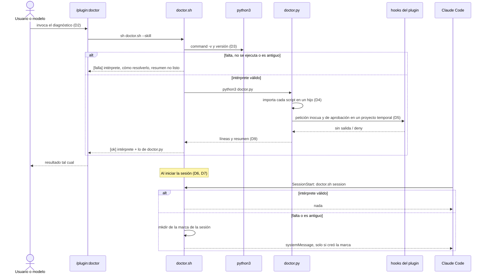
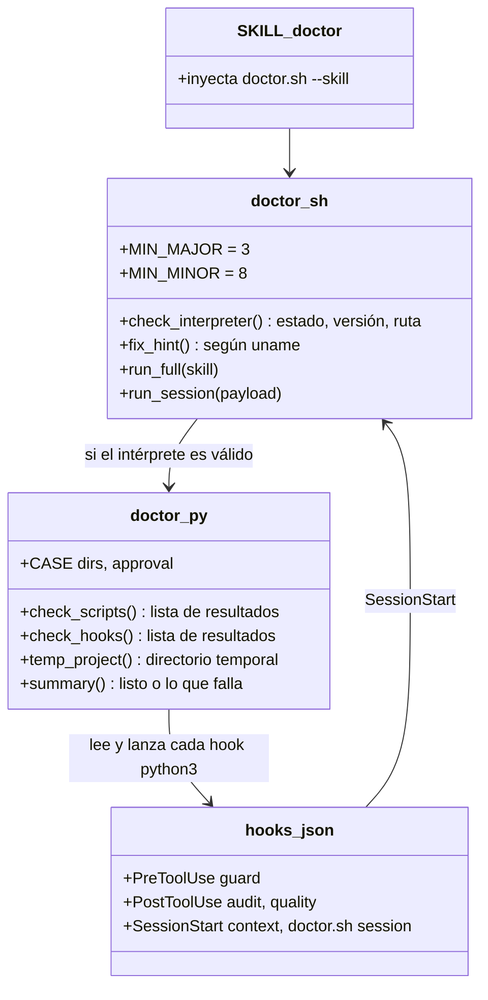

# Plan: comando de diagnóstico por plugin: python3, scripts y hooks, con aviso al iniciar la sesión

| Campo  | Valor              |
| ------ | ------------------ |
| Spec   | `spec.md`          |
| Fecha  | 2026-11-04         |
| Estado | Approved · 2ca6b0b6818e              |

> Este documento describe **cómo**. Si aquí aparece un requisito nuevo que no
> está en `spec.md`, el sitio correcto es `spec.md`, no aquí.
>
> Sustituye todo texto en cursiva; si una sección no aplica, escribe
> «No aplica.». Solo el usuario cambia el Estado, con `/sdd:approve`.

## Resumen

Cada plugin gana una skill `/<plugin>:doctor` y un hook `SessionStart`, los dos
sobre dos scripts nuevos:
- `scripts/doctor.sh`, en shell POSIX, comprueba el intérprete;
- `scripts/doctor.py` comprueba que los scripts arrancan y que los hooks
  responden.

La decisión clave es partir el diagnóstico en dos lenguajes: solo un shell puede
decir que falta Python sin depender de Python.

El aviso de inicio no se repite gracias a una marca por sesión que crea el
primer plugin que avisa. Ningún plugin depende de los demás para avisar.

## Comprobación de constitución

| Regla | ¿Se cumple? | Cómo, o excepción justificada |
| ----- | ----------- | ----------------------------- |
| Lo determinista vive en un script | sí | El diagnóstico entero es `doctor.sh` y `doctor.py`; la skill solo muestra el resultado y explica qué hacer (D2). |
| Lo determinista «son código Python»; Python 3.8 y biblioteca estándar como único lenguaje | no: excepción justificada | `doctor.sh` está en shell porque su trabajo es informar cuando Python falta o no sirve, y eso no puede hacerlo código Python (D1). La excepción se limita a ese archivo: comprueba el intérprete y cede a `doctor.py`, y no contiene ninguna otra lógica. Solo usa utilidades POSIX presentes donde corre Claude Code (`command -v`, `sed`, `uname`, `mkdir`), sin dependencias que instalar. Como `validate.py` solo compila los `.py`, la vigilancia mecánica la hace el selftest (D8): `sh -n` sobre cada copia y la ejecución en CI con `dash`. Conviene registrar la excepción en la constitución con `/sdd:constitution`, al terminar la feature. |
| Cada plugin funciona sin los demás; plugins unidos solo por archivos | sí | Cada plugin lleva su copia de los dos scripts y solo mira su propio directorio y su `hooks.json`. El reparto del aviso usa una marca en el directorio temporal, no código de otro plugin (D7). |
| Un guardrail falla abierto y siempre tiene escape | sí | El hook de inicio sale siempre con 0 y no usa `set -e`. Un fallo no impide la sesión (D6). No bloquea nada, así que no necesita escape. |
| Un guardrail nunca concede permisos | sí | El hook de inicio no emite `permissionDecision`. El diagnóstico da por fallido un hook cuya salida contiene `allow` (D5). |
| Lo que bloquea lo decide una persona | sí | El diagnóstico no aprueba ni bloquea nada, así que la skill no lleva `disable-model-invocation`: la pueden lanzar el usuario o el modelo, como pide la spec. Las peticiones de prueba a los guardrails van sobre un proyecto temporal (D5). |
| Python 3.8 como mínimo, solo biblioteca estándar | sí | `doctor.py` usa `subprocess`, `tempfile`, `json` y `pathlib`. La versión mínima 3.8 está fijada en `doctor.sh` (D3). |
| Hooks en forma exec, con `timeout` y `${CLAUDE_PLUGIN_ROOT}` | sí | `"command": "sh", "args": ["${CLAUDE_PLUGIN_ROOT}/scripts/doctor.sh", "session"], "timeout": 5`. |
| Selftest por plugin; todo código de hallazgo alcanzable | sí | Cada selftest prueba su diagnóstico (ver «Estrategia de pruebas»). El diagnóstico no declara códigos `E-`/`W-`: sus comprobaciones no son hallazgos de artefacto, así que no cambia la comparación de códigos. |
| Prefijos de hallazgo reservados antes de usarse | no aplica | No se crean códigos ni schemas (D9). |
| Código copiado: comentario que nombra el original y las copias, y prueba de contrato | sí | `doctor.sh` es idéntico en los cinco plugins, y `doctor.py` lo es salvo el bloque `CASE` del principio. Los dos llevan el comentario de copias. Cada selftest compara su copia con las demás presentes en el repositorio (D8). |
| Sin red ni datos fuera de la máquina | sí | Nada sale de la máquina. Lo único que se escribe fuera del plugin va al directorio temporal: el proyecto de prueba y la marca del aviso. |
| Idioma en español | sí | Mensajes, skills, README y commits en español. |

## Decisiones

### D1 — Diagnóstico en dos piezas: shell para el intérprete, Python para lo demás

- **Contexto:**
  - R002 exige informar sin el intérprete, y R008 avisar cuando falta.
  - R003 y R004 exigen lanzar scripts y hooks, comparar su salida JSON y montar
    un proyecto de prueba. Eso en shell es frágil y difícil de probar.
- **Decisión:**
  - `scripts/doctor.sh` (POSIX `sh`, sin bashismos) busca el intérprete, lee su
    versión y la compara con la mínima.
  - Solo si el intérprete es válido, cede a `python3 scripts/doctor.py`, que
    hace R003, R004 y el resumen.
  - Si `doctor.py` no llega a imprimir su resumen, porque revienta o porque él
    mismo no arranca, `doctor.sh` lo dice como fallo de scripts y muestra su
    salida de error.
- **Alternativas descartadas:**
  - Todo en Python: no puede decir que falta Python (R002).
  - Todo en shell: la comprobación de los hooks dependería de `grep` sobre JSON
    y de utilidades que cambian entre macOS, Linux y Git Bash.
- **Consecuencias:**
  - Dos archivos más por plugin.
  - El shell queda como dependencia. Es el supuesto de la spec, porque Claude
    Code ya exige `bash` (Git Bash en Windows).

### D2 — La skill `/<plugin>:doctor` ejecuta el diagnóstico al invocarse

- **Contexto:** el diagnóstico lo lanzan el usuario o el modelo, y su resultado
  tiene que ser el mismo lo lance quien lo lance.
- **Decisión:**
  - `skills/doctor/SKILL.md` en cada plugin, sin `disable-model-invocation`, con
    `allowed-tools: Bash(sh:*)`.
  - La skill inyecta el resultado con
    `` !`sh "${CLAUDE_PLUGIN_ROOT}/scripts/doctor.sh" --skill` ``.
  - La skill dice al modelo que lo muestre tal cual y que, si algo falla,
    explique la corrección que el propio resultado indica. No debe instalar
    nada (spec, «Fuera»).
- **Alternativas descartadas:** que la skill describa las comprobaciones y las
  haga el modelo con Bash. Viola el principio 1, y el resultado variaría de una
  vez a otra.
- **Consecuencias:** como las demás skills con `!`, el diagnóstico corre al
  cargarse la skill, también cuando la invoca el modelo.

### D3 — Comprobación del intérprete en `doctor.sh`

- **Contexto:**
  - El intérprete puede faltar, estar pero no ejecutarse, o ser antiguo. Un
    caso típico de lo segundo es el alias de la Microsoft Store en Windows.
  - La comparación no puede depender de que el intérprete sea moderno.
- **Decisión:**
  - Los estados y el intérprete:
    - `PY=${DOCTOR_PYTHON:-python3}`. `DOCTOR_PYTHON` existe solo para las
      pruebas, y su comentario lo dice. Los hooks siguen usando `python3`.
    - `command -v "$PY"` sin resultado → **falta**.
    - `"$PY" -c 'import sys; print("%d.%d.%d" % sys.version_info[:3])'`, con una
      sintaxis válida incluso en Python 2, que falla o no imprime una versión →
      **no se ejecuta**, con su salida.
    - Mayor y menor comparados en aritmética de shell con `MIN_MAJOR=3` y
      `MIN_MINOR=8`, la mínima de la constitución → **antigua** o **bien**.
      El resultado bueno informa la versión y la ruta (R001).
  - Qué dice si falla (R002):
    - que las comprobaciones y los guardrails del plugin no funcionan, y que
      los guardrails dejan pasar todo;
    - en `sdd`, además, que la compuerta no funciona. Solo `sdd` tiene
      compuerta, y `doctor.sh` es idéntico en los cinco plugins (D8), así que
      añade esa frase si el plugin tiene `scripts/sdd.py`. No afirma en los
      otros cuatro algo que no tienen;
    - cómo resolverlo según `uname`: macOS (`brew install python@3.12` o
      python.org), Linux (el gestor de paquetes de la distribución) y Windows
      o Git Bash (python.org, con `python3` en el `PATH`);
    - que después se reinicie la sesión y se repita `/<plugin>:doctor`.
- **Alternativas descartadas:**
  - Analizar `python3 --version`: Python 2 escribe en stderr y el alias de la
    Store responde con otro texto.
  - Comparar la versión en Python: es justo lo que no podemos dar por bueno.
- **Consecuencias:** la versión mínima vive en la constitución y en `doctor.sh`.
  Subirla obliga a cambiar las cinco copias, y la prueba de copias lo recuerda
  (D8).

### D4 — «Los scripts arrancan»: importar cada script en un proceso hijo

- **Contexto:** R003 pide nombrar el script que no arranca y su error. Un error
  de sintaxis o de importación en un módulo auxiliar (`sdd_trace.py`,
  `release_specs.py`) rompe el plugin sin que el script principal lo muestre
  hasta usarlo.
- **Decisión:**
  - Para cada `scripts/*.py` salvo `doctor.py`, un proceso hijo con
    `sys.executable` carga el módulo por ruta (`importlib.util`):
    - con `scripts/` en `sys.path`;
    - con `cwd` en el proyecto temporal de D5;
    - con `PYTHONDONTWRITEBYTECODE=1`.
  - Los scripts guardan su `main` tras `if __name__ == "__main__"`, así que
    cargar un módulo no ejecuta nada.
  - Si el proceso sale con un código distinto de 0, el resultado nombra el
    script y muestra la última línea de su error, la del tipo de excepción.
  - Que el script principal **responde** lo prueba D5: sus hooks son
    subcomandos suyos.
- **Alternativas descartadas:**
  - `py_compile`: no detecta los fallos de importación y escribe `.pyc`.
  - Ejecutar cada script sin argumentos: los módulos auxiliares no tienen
    `main`.
- **Consecuencias:** un script nuevo en `scripts/` entra solo en la
  comprobación.

### D5 — «Los hooks responden»: `hooks.json` del plugin contra un proyecto temporal

- **Contexto:**
  - R004 exige que cada guardrail impida una aprobación de prueba y deje pasar
    una operación inocua.
  - R005 prohíbe tocar el proyecto.
  - Todos los guardrails resuelven la raíz con `CLAUDE_PROJECT_DIR` y, si no
    está, con el `cwd` del payload.
- **Decisión:**
  - **Qué se comprueba.** `doctor.py` lee el `hooks.json` de su plugin y lanza
    cada hook cuyo `command` es `python3`, con sus `args` tal cual. Usa
    `${CLAUDE_PLUGIN_ROOT}` sustituido, `sys.executable` y el `timeout` del
    propio hook. El hook en `sh` es el diagnóstico mismo y no se relanza.
    Un hook nuevo entra solo.
  - **Guardrails y otros hooks.** R004 habla de guardrails: los `guard` y
    `audit` de cada plugin. `sdd` registra además dos hooks que no son
    guardrails, `quality` y `context`. Se comprueban igual, porque eso es lo
    que el usuario eligió («Los hooks responden») y porque un hook que revienta
    sin Python también deja de hacer su trabajo. El resultado los nombra por
    separado: `[ok] guardrail guard`, `[ok] hook quality`. Así, un fallo de
    `quality` se ve como lo que es y no como un guardrail que no protege.
  - **Dónde.** Un proyecto temporal de `tempfile.mkdtemp()`, fuera del
    proyecto y borrado al terminar:
    - con los directorios que el guardrail necesita para actuar
      (`CASE["dirs"]`: `product/`, `architecture/`, `specs/`, `releases/`,
      `operations/`);
    - con el entorno del hijo con `CLAUDE_PROJECT_DIR` en ese proyecto y `cwd`
      igual, para que nada resuelva al proyecto real;
    - sin ninguna variable que termine en `_BYPASS`: avisar de los escapes queda
      fuera de alcance, pero el diagnóstico debe probar el guardrail, no el
      escape.
  - **Peticiones de prueba**, todas sin escribir nada: solo se pasan por stdin.
    - Inocua, a todo hook `PreToolUse` y `PostToolUse` cuyo `matcher` acepta
      `Write`: `Write` a `notas.md`. Es un `.md` exento de la compuerta de `sdd`
      y no protegido por los demás. Pasa si sale con 0 y su salida no contiene
      `deny`.
    - Aprobación, al hook `PreToolUse` cuyo último argumento es `guard`: `Write`
      de `CASE["approval"]` (ruta y contenido con `Estado` en `Approved`). Pasa
      si su salida es un JSON con `permissionDecision: "deny"`.
    - Los hooks `PostToolUse` de `Bash` (`audit`) reciben un `Bash` con
      `command: "true"` y sin instantánea previa. Pasan si salen con 0 sin
      revertir nada.
    - `SessionStart` (`sdd.py context`) recibe su payload y pasa si sale con 0.
    - En todos los casos, una salida que contiene `"allow"` es un fallo.
  - Las aprobaciones de prueba (`CASE["approval"]`):
    - discovery: `product/brief.md`;
    - architecture: `architecture/quality.md`;
    - sdd: `specs/001-prueba/spec.md`;
    - release: `releases/v0.0.1.md`;
    - operate: `operations/v0.0.1.md`.
- **Alternativas descartadas:**
  - Probar contra el proyecto real: un `Bash` haría que la guarda escribiera su
    instantánea en él (R005), y lo que haya en el proyecto cambiaría el
    resultado.
  - Llamar a las funciones de guarda importándolas: no probaría lo que ejecuta
    Claude Code, que es el comando de `hooks.json`.
- **Consecuencias:** las rutas y el formato de `CASE` repiten conocimiento de
  cada guardrail. Si un guardrail cambia sus archivos protegidos, el selftest
  del plugin falla en la prueba de R004 hasta actualizar `CASE`.

### D6 — Aviso al iniciar: hook `SessionStart` que llama a `doctor.sh session`

- **Contexto:**
  - R008, R009, R010 y N001.
  - La salida de un `SessionStart` llega al modelo como contexto, y
    `systemMessage` la muestra al usuario.
- **Decisión:**
  - Se añade un `SessionStart` a los cinco `hooks.json`; en `sdd`, junto a
    `context`. Forma exec, `timeout` de 5.
  - En modo `session`, `doctor.sh` hace solo la comprobación de D3. Si está
    bien, no escribe nada.
  - Si no, escribe un JSON con:
    - `systemMessage`: el problema en una frase y «Ejecuta /<plugin>:doctor
      para el detalle»;
    - `hookSpecificOutput.additionalContext`: lo mismo para el modelo, más que
      los guardrails no protegen.
  - El texto no lleva comillas ni barras invertidas, así que el JSON se escribe
    sin escapes.
  - Sale siempre con 0, sin `set -e`, y redirige los errores de cada paso.
  - El nombre del plugin sale de `.claude-plugin/plugin.json` con `sed`. Si no
    se puede leer, usa `doctor`.
- **Alternativas descartadas:**
  - Que el `SessionStart` de `sdd` (`context`) avise: necesita Python, y solo
    está en `sdd`.
  - Ejecutar `doctor.py` completo al iniciar: superaría N001 en el peor caso, y
    la spec solo pide avisar del intérprete.
- **Consecuencias:**
  - Cinco hooks más en el arranque, de unos milisegundos cada uno.
  - Si falta Python, el `SessionStart` de `sdd context` también falla. Claude
    Code lo muestra como un error del hook, sin bloquear.

### D7 — Un único aviso por sesión: marca atómica en el directorio temporal

- **Contexto:** con los cinco plugins y sin intérprete, cada hook avisaría
  (R011), y ningún plugin puede depender de los demás (R007).
- **Decisión:**
  - **El reparto.** `doctor.sh session` lee el `session_id` del payload con
    `sed`, se queda solo con `[A-Za-z0-9_-]` e intenta
    `mkdir "${TMPDIR:-/tmp}/edwinlabs-doctor.$id"`, que es atómico.
    - Quien lo crea avisa.
    - Si ya existía, otro plugin avisó en esta sesión y calla.
    - Si no hay `session_id`, o el `mkdir` falla por otra causa (directorio sin
      permisos), avisa igual: mejor repetido que callado (R008 es MUST y R011,
      SHOULD).
  - **El texto** es común a la serie («los plugins de edwinlabs-engineering-tools
    instalados no protegen…») y nombra el diagnóstico del plugin que avisó.
    Cualquiera de ellos detalla el mismo intérprete.
- **Alternativas descartadas:**
  - Mensajes distintos por plugin: dejan de ser idénticos pero siguen siendo
    cinco, y R011 pide evitar la repetición.
  - Que solo un plugin tenga el aviso: rompe R007 si ese no está instalado.
  - La marca en el proyecto (`.sdd/`): escribe en el proyecto, y no todos los
    proyectos tienen ese directorio.
- **Consecuencias:**
  - Tras compactar o reanudar, la sesión conserva su `session_id` y no se repite
    el aviso. El usuario ya lo vio.
  - Las marcas, directorios vacíos, se quedan en el temporal hasta que el
    sistema lo limpia.

### D8 — Copias idénticas y su prueba

- **Contexto:** los plugins no comparten código (constitución), y el
  diagnóstico es el mismo en los cinco salvo las peticiones de prueba.
- **Decisión:**
  - `doctor.sh` es idéntico en los cinco plugins.
  - `doctor.py` lleva arriba el bloque `CASE`, propio de cada plugin, y debajo
    de la línea `# --- común a las cinco copias ---` un cuerpo idéntico.
  - Los dos llevan el comentario que nombra las cinco copias. El original es el
    de `sdd`.
  - Cada selftest compara su `doctor.sh`, y el cuerpo común de su `doctor.py`,
    con los de los demás plugins que estén en el repositorio. Fuera del
    repositorio la prueba se salta.
  - El comentario de copias nombra las cinco desde el principio (T001), porque
    el archivo es idéntico byte a byte.
  - La misma prueba ejecuta `sh -n` sobre su `doctor.sh`. Es la comprobación
    mecánica de sintaxis que `validate.py` no hace para los `.sh`.
- **Alternativas descartadas:**
  - Un generador que escriba las copias: es una herramienta más que mantener
    para dos archivos.
  - Un diagnóstico central: rompe R007.
- **Consecuencias:** un cambio del diagnóstico se aplica en cinco sitios, y el
  selftest falla hasta que las copias coinciden.

### D9 — Formato de salida y códigos de salida

- **Contexto:** R006 pide el resultado de cada comprobación y un resumen.
- **Decisión:**
  - **Formato.** Una línea por comprobación con `[ok]` o `[falla]`, y las líneas
    de detalle sangradas debajo. Al final, una línea
    `Resumen: <plugin> está listo.` o
    `Resumen: <plugin> no está listo: <lo que falla, separado por comas>.`
  - **Qué se muestra.** Si el intérprete falla, las comprobaciones de scripts y
    hooks aparecen como `[--] sin comprobar: necesitan el intérprete`.
  - **Códigos de salida.**
    - 0 si el plugin está listo, 1 si no, y 2 si el uso es incorrecto.
    - Con `--skill` sale siempre con 0, como `release.py approve --skill`, para
      que la skill muestre el resultado.
  - No hay JSON, ni schema, ni códigos `E-`/`W-`.
- **Alternativas descartadas:** reutilizar el formato de hallazgos y un schema.
  El diagnóstico no comprueba artefactos, y un schema más sería contrato
  público sin consumidor.
- **Consecuencias:** si algún día CI lo quiere en JSON, se añade un schema.

## Componentes afectados

| Componente | Cambio | Requisitos que cubre |
| ---------- | ------ | -------------------- |
| `plugins/
/scripts/doctor.sh` (×5) | Nuevo: intérprete, modo `--skill`, modo `session` con marca | R001, R002, R006, R007, R008, R009, R010, R011 |
| `plugins/
/scripts/doctor.py` (×5) | Nuevo: `CASE` del plugin, scripts y hooks contra un proyecto temporal, resumen | R003, R004, R005, R006, R007 |
| `plugins/
/skills/doctor/SKILL.md` (×5) | Nueva skill que inyecta el resultado | R001, R006 |
| `plugins/
/hooks/hooks.json` (×5) | `SessionStart` con `doctor.sh session` | R008, R009, R010 |
| `plugins/
/tests/selftest.py` (×5) | Pruebas del diagnóstico del plugin y de las copias | R003, R004, R005, R006, R007 |
| `plugins/sdd/tests/selftest.py` | Pruebas de `doctor.sh` (intérprete, aviso, marca, tiempo) | R001, R002, R008, R009, R010, R011 |
| `plugins/
/README.md` (×5), `README.md` | Sección «Diagnóstico»; en la instalación, ejecutar `/
:doctor` tras instalar | R006 |

## Modelo de datos

No aplica: no hay artefactos nuevos en el proyecto. La única marca persistente
es el directorio vacío de D7, en el temporal del sistema.

## Contratos

- `sh scripts/doctor.sh [--skill]`: el diagnóstico completo.
  - Salida: el formato de D9.
  - Sale con 0 si el plugin está listo, 1 si no y 2 si el uso es incorrecto.
    Con `--skill`, siempre con 0.
- `sh scripts/doctor.sh session`, el hook `SessionStart`:
  - lee el payload por stdin;
  - si el intérprete está bien, no escribe nada;
  - si no, escribe
    `{"systemMessage": "…", "hookSpecificOutput": {"hookEventName": "SessionStart", "additionalContext": "…"}}`;
  - sale siempre con 0.
- `python3 scripts/doctor.py <plugin>`: solo lo llama `doctor.sh`.
  - Escribe las líneas de scripts y hooks y el resumen.
  - Sale con 0 si está listo y 1 si no.
- `DOCTOR_PYTHON`: variable de entorno solo para pruebas, que sustituye a
  `python3` en `doctor.sh`.
- `CASE` en `doctor.py`:
  `{"dirs": [...], "approval": {"file_path": "...", "content": "..."}}`.

## Diagramas

### Secuencia

### Modelo de datos

No aplica.

### Clases

## Estrategia de pruebas

Las pruebas de `doctor.sh` viven en el selftest de `sdd`, el original, y valen
para las cinco copias porque D8 prueba que son idénticas. Las de `doctor.py`
van en el selftest de cada plugin, porque `CASE` y los hooks cambian por plugin.

| Requisito | Tipo de prueba | Dónde vive |
| --------- | -------------- | ---------- |
| R001 | integración: `doctor.sh` con el intérprete real dice `[ok]` y la versión de `sys.version_info`; con `DOCTOR_PYTHON` falso que responde 3.11.4, dice 3.11.4 | `plugins/sdd/tests/selftest.py` |
| R002 | integración: con `DOCTOR_PYTHON` inexistente, dice que falta, que la compuerta y los guardrails no funcionan, y cómo instalarlo, y no ejecuta `doctor.py`; con uno que responde 3.6.15, dice que 3.6 es anterior a 3.8; con uno que sale con 9009, dice que no se ejecuta | `plugins/sdd/tests/selftest.py` |
| R003 | integración: una copia del plugin en el temporal con un script roto (error de sintaxis) da `[falla]` con su nombre y el error | selftest de cada plugin |
| R004 | integración: el plugin real da `[ok]` en cada hook; una copia con `guard` que siempre sale con 0 da `[falla]` en el guardrail y «no está listo» | selftest de cada plugin |
| R005 | integración: diagnóstico con el `cwd` en un proyecto con artefactos en borrador y aprobados; la huella de todos sus archivos es la misma antes y después | selftest de cada plugin |
| R006 | integración: con un guardrail roto, el resumen dice «no está listo» y nombra el guardrail; el plugin real dice «está listo» | selftest de cada plugin |
| R007 | integración: una copia solo del directorio del plugin, sin los demás, da «está listo» | selftest de cada plugin |
| R008 | integración: `doctor.sh session` sin intérprete escribe un JSON con `systemMessage` que nombra `/sdd:doctor` | `plugins/sdd/tests/selftest.py` |
| R009 | integración: `doctor.sh session` con el intérprete real no escribe nada y sale con 0 | `plugins/sdd/tests/selftest.py` |
| R010 | integración: con un payload que no es JSON y con `TMPDIR` inexistente, `doctor.sh session` sale con 0 | `plugins/sdd/tests/selftest.py` |
| R011 | integración: cinco ejecuciones de `doctor.sh session` con el mismo `session_id` y sin intérprete dan un solo aviso; con otro `session_id`, otro aviso | `plugins/sdd/tests/selftest.py` |
| N001 | integración: `doctor.sh session` con el intérprete real termina en menos de 1 s | `plugins/sdd/tests/selftest.py` |
| R008 en cada plugin | integración: `doctor.sh session` de la copia del plugin, sin intérprete, nombra `/<plugin>:doctor` (por ejemplo `/release:doctor`) | selftest de cada plugin |
| copias (D8) | contrato: `doctor.sh` y el cuerpo común de `doctor.py` iguales a los de los demás plugins del repositorio; `sh -n` sobre `doctor.sh` | selftest de cada plugin |

Las pruebas siguen la convención `test_F012_R001_interprete_bien`, y `validate.py --strict`
comprueba los `hooks.json` nuevos. El CI ejecuta los selftests en Linux, donde
`sh` es `dash`: eso prueba que `doctor.sh` es POSIX.

## Riesgos técnicos

| Riesgo | Impacto | Mitigación |
| ------ | ------- | ---------- |
| `doctor.sh` usa algo que no es POSIX y falla en `dash` o en Git Bash | El diagnóstico o el aviso no funcionan en esa plataforma | CI en Linux con `dash`; solo `command -v`, `sed`, `uname`, `mkdir` y aritmética `$(( ))`. |
| El `PATH` de la skill difiere del de los hooks | El diagnóstico da por bueno un intérprete que los hooks no encuentran | Es un supuesto de la spec. El resultado muestra la ruta del intérprete para que se vea. |
| `CASE` se desfasa del guardrail | Falso «no está listo» | La prueba de R004 en cada selftest falla en el mismo commit que cambia el guardrail. |
| Un hook que tarda (el `quality` de `sdd` con formateador) alarga el diagnóstico | Diagnóstico lento | Se usa el `timeout` del propio hook, y la petición inocua a `notas.md` no tiene formateador configurado en el proyecto temporal. |
| El payload de `SessionStart` cambia de forma y no trae `session_id` | Se repite el aviso | Se avisa igual: R011 es SHOULD, y callar violaría R008. |

## Trazabilidad

Todos los requisitos MUST (R001–R010) aparecen en la tabla de componentes y en
la de pruebas. R011 (SHOULD) y N001 también tienen prueba. No queda ningún
requisito sin cubrir.
